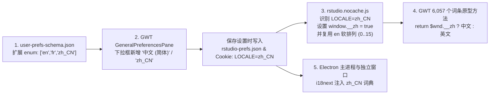

# RStudio Desktop 简体中文语言包 (rstudio-zh)

[](LICENSE)
[](#)
[-red.svg)](#)

为 **RStudio Desktop** 原生增加第三个界面语言选项 —— **「中文 (简体) (`zh_CN`)」**，在不破坏官方原有 `English (en)` 与 `French (fr)` 的前提下，实现全界面 **100% 简体中文化**。

---

## ✨ 功能特性

- **原生三语自由切换**：在 `Tools -> Global Options -> General -> Advanced -> User Interface Language`（`工具 -> 全局选项 -> 常规 -> 高级 -> 用户界面语言`）下拉框中原生新增第 3 个选项 **`中文 (简体)`**，可随时在 **English / French / 中文 (简体)** 之间无损切换。
- **全界面 100% 覆盖（共 6,164 条词条）**：
  - **顶部一级菜单与多级展开子菜单**（`MenuConstants` 34 项 + `CmdConstants` 1,450 项，完整保留 Windows 快捷键助记符 `(_F)`、`(_E)` 等及 `Toggle DevTools` 诊断菜单）。
  - **全局选项与项目选项设置页**（`PrefsConstants` 612 项 + `UserPrefsAccessorConstants` 677 项）。
  - **Quarto / R Markdown 可视化富文本编辑器**（`PanmirrorConstants` 194 项）。
  - **全部工作区窗格、工具栏与模态对话框**（控制台、源代码编辑器、环境、文件、绘图、程序包、历史记录、连接、构建、终端、Git/SVN 版本控制、后台任务、教程等共 108 个 GWT 国际化类、6,057 个词条方法 + CLDR 日期时间本地化）。
  - **Electron 宿主与 4 个独立辅助窗口**（R 版本选择窗口、启动加载窗口、连接窗口、错误诊断窗口共 107 项 `i18next` 词条）。
- **基于 `symbolMap.gz` 动态符号解析**：不硬编码混淆后的 JS 函数名，自动解析 RStudio 内置的 `www-symbolmaps/<HASH>.symbolMap.gz` 进行符号级精准注入。
- **自动备份与一键还原**：首次安装时自动将原版文件备份至 RStudio 目录下的 `.rstudio_zh_backup`，随时可一键恢复至 100% 官方原版状态。

---

## 🚀 快速开始（一键安装与还原）

### 前置条件
- 已安装 **RStudio Desktop**（支持 `2026.x` / `2024.x` / `2025.x` 等包含 `www-symbolmaps` 的桌面版本）
- 已安装 **Python 3.7+**（无需安装任何第三方依赖库，纯标准库实现）
- **注意**：如果您的 RStudio 安装在 `C:\Program Files\RStudio` 等系统受保护目录，请**右键「以管理员身份运行」**批处理脚本或终端。

### 方式一：Windows 双击一键运行
1. 关闭正在运行的 RStudio。
2. 双击运行仓库根目录下的 **[`一键安装中文(Install).bat`](一键安装中文(Install).bat)** 即可完成备份、汉化注入、`.gz` 同步重压缩与缓存清理，并自动将默认界面语言设为 `zh_CN`。
3. 如需恢复官方原版，双击运行 **[`一键还原原版(Restore).bat`](一键还原原版(Restore).bat)** 即可。

### 方式二：命令行运行（支持 Windows / macOS / Linux）

```bash
# 查看当前 RStudio 路径与汉化状态（自动检测安装目录）
python rstudio_zh.py status

# 一键安装中文选项与全量汉化包
python rstudio_zh.py install

# 若安装在自定义路径且未被自动检测到，可通过 --dir 指定目录：
python rstudio_zh.py install --dir "D:\RStudio"

# 一键还原为官方原版
python rstudio_zh.py restore
```

---

## 🔍 逆向原理与实现机制

RStudio Desktop 的多语言体系横跨 **C++ 会话后端 (`rsession.dll`)**、**GWT 编译前端 (`www/rstudio/`)** 和 **Electron 宿主进程 (`.webpack/`)** 三层，通过 `ui_language` 配置项与浏览器 Cookie `LOCALE` 协同工作：



1. **C++ 后端配置校验层 (`resources/schema/user-prefs-schema.json`)**  
   `rsession.dll` 中的 `rstudio::session::prefs::UserPrefsLayer` 通过读取 `user-prefs-schema.json` 校验 `rstudio-prefs.json`。将 `"ui_language"` 的 `"enum"` 扩展为 `["en", "fr", "zh_CN"]` 后，C++ 后端即可合法持久化保存 `"zh_CN"`。
2. **GWT 引导器软排列复用 (`www/rstudio/rstudio.nocache.js`)**  
   GWT 编译产物将 5 个属性组合映射为 `0..31` 共 32 个软排列 ID（`0..15` 为 `en`，`16..31` 为 `fr`），供 252 个 `ClientBundle` 资源工厂与 22 个平台适配工厂使用。我们在 `rstudio.nocache.js` 解析 `LOCALE` Cookie 时设置全局变量 `window.__zh = (c.indexOf('zh') === 0)`，并让 `zh_CN` 复用 `0..15` 软排列槽位，从而保证所有图标、样式表与平台实现 100% 正常工作。
3. **GWT 108 个国际化类原型方法织入 (`<HASH>.cache.js` & `deferredjs/`)**  
   利用 `www-symbolmaps/<HASH>.symbolMap.gz` 符号表定位全部 6,057 个 `*_en` 原型方法，将其返回语句改造为 `return $wnd.__zh ? <中文表达式> : <原英文表达式>`，既不污染底层共享字符串常量池，又保证了 `en` / `fr` / `zh_CN` 三语完全独立。
4. **解决 `.cache.js.gz` 预压缩优先分发与强缓存问题**  
   `rsession.dll` 内置 HTTP 服务在检测到同名 `.cache.js.gz` 存在时会优先返回 `.gz` 文件，且 Chromium 会将静态资源强缓存在 `%APPDATA%\RStudio\web-cache`。本工具在修补 `.cache.js` 后会自动同步更新所有 `.cache.js.gz` 并清理 `web-cache`。
5. **Electron `i18next` 内联词典注入 (`.webpack/main` & `.webpack/renderer`)**  
   向 Webpack 打包后的 `initI18n()` 资源对象动态注入 `zh_CN` 词典，并让 `MenuCallback.prototype.menuBegin` 同时匹配中文的 `"工具(&T)"` 与 `"诊断(&G)"`。

---

## 📂 目录结构与自定义词条

```text
rstudio-zh/
├── rstudio_zh.py                      # 跨平台一键安装 / 还原 / 状态检测主程序
├── 一键安装中文(Install).bat           # Windows 一键安装批处理脚本
├── 一键还原原版(Restore).bat           # Windows 一键还原批处理脚本
├── dictionaries/
│   ├── gwt_zh_CN_by_symbol.json       # GWT 主界面全量词典 (6,057 条，按 Java 类名::方法名 索引)
│   ├── electron_zh_CN.json            # Electron 主进程与独立窗口中文词典 (107 条)
│   └── electron_fr.json               # Electron 官方原版法文词典
├── README.md
└── LICENSE
```

如需微调任何界面翻译，只需直接编辑 [`dictionaries/gwt_zh_CN_by_symbol.json`](dictionaries/gwt_zh_CN_by_symbol.json) 或 [`dictionaries/electron_zh_CN.json`](dictionaries/electron_zh_CN.json)，然后重新运行 `python rstudio_zh.py install` 即可立即生效。

---

## 📄 开源协议

本项目采用 [MIT License](LICENSE) 开源。
